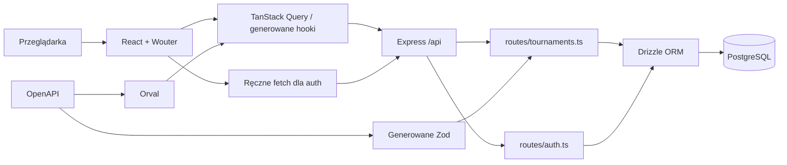

# Audyt struktury aplikacji Tournament Manager

> Status: dokument historyczny. Wnioski dotyczą stanu kodu z chwili audytu;
> bieżący model wyników opisuje `ADR_SERIES_V1_CLEAN_CUTOVER.md`.

Data audytu: 2026-07-14
Zakres: cały kod śledzony w repozytorium, konfiguracja workspace, frontend, API, baza danych, generowany klient i schematy, skrypty uruchomieniowe oraz dostępne mechanizmy testowania.
Charakter audytu: analiza bez szerokiego refaktoru; w kodzie produktu nie wprowadzono zmian.

## 1. Sposób czytania ustaleń

W dokumencie używane są cztery poziomy pewności:

- **Zweryfikowane w runtime** — zachowanie zostało faktycznie uruchomione i zaobserwowane.
- **Potwierdzone w kodzie** — wynika bezpośrednio z kompletnej ścieżki wykonania lub konfiguracji.
- **Prawdopodobne** — silny wniosek z kodu, ale wymaga bazy danych albo scenariusza end-to-end.
- **Nieweryfikowalne lokalnie** — zabrakło wymaganej usługi, sekretu, danych lub konfiguracji.

Priorytety:

- **P0** — możliwość utraty, ujawnienia lub korupcji danych albo ominięcia kluczowej granicy bezpieczeństwa.
- **P1** — ważna wada funkcjonalna lub strukturalna, którą trzeba usunąć przed bezpiecznym rozwojem.
- **P2** — istotny dług techniczny, błąd brzegowy lub ryzyko utrzymania.
- **P3** — usprawnienie jakości, dokumentacji, wydajności lub ergonomii.

## 2. Podsumowanie wykonawcze

Aplikacja ma spójny technologicznie fundament: React, Express, PostgreSQL, Drizzle, Zod, OpenAPI i TanStack Query. TypeScript przechodzi w całym workspace, schemat danych jest czytelny, a podstawowe obszary turnieju — gracze, mecze, wyniki, historia, backup i kilka formatów — są już połączone w jeden produkt.

Największe ryzyko nie leży w wyborze technologii, lecz w braku wyraźnej granicy domenowej i w nierównym egzekwowaniu uprawnień. Część odczytów prywatnego turnieju oraz pełny eksport omijają kontrolę widza, generowanie rundy szwajcarskiej omija kontrolę gospodarza, a turniej bez skonfigurowanego hasła może być modyfikowany i usuwany anonimowo. Operacja kończenia meczu nie jest atomowa ani idempotentna i przyjmuje zwycięzcę, który nie musi być uczestnikiem tego meczu. To są problemy P0.

Kod jest jednocześnie zbyt skupiony w kilku plikach: `routes/tournaments.ts` ma ponad 2300 linii, `tournament-host.tsx` około 1740, a `tournament-detail.tsx` około 1340. Reguły turniejowe, SQL, autoryzacja, serializacja odpowiedzi i obsługa HTTP są połączone w kontrolerach. Po stronie klienta strony łączą routing, dostęp, wiele zapytań, logikę formularzy i duże fragmenty UI. Rozszerzanie aplikacji bez najpierw dodanych testów kontraktowych i domenowych będzie pogłębiać ryzyko regresji.

Nie ma testów automatycznych, lintingu, CI, migracji ani przykładowej konfiguracji środowiska. Build produkcyjny dał się wykonać po lokalnym obejściu problemu z natywnym pakietem Rollup dla Windows, ale standardowy build repozytorium na tej maszynie nie przechodzi. Backend nie mógł zostać uruchomiony z prawdziwą bazą, bo nie było `DATABASE_URL`. Frontend został uruchomiony i ujawnił brak routingu `/api` w Vite: zapytanie API dostało `index.html`, a dashboard zakończył się błędem `tournaments?.find is not a function`.

Rekomendacja: nie przepisywać aplikacji. Najpierw zamknąć granice bezpieczeństwa i integralności w istniejącym stosie, otoczyć je testami integracyjnymi, a następnie małymi krokami wydzielać przypadki użycia i repozytoria z obecnego kontrolera.

## 3. Inwentaryzacja repozytorium

### 3.1. Workspace i technologie

| Warstwa | Technologia / moduł | Rola |
|---|---|---|
| Workspace | pnpm, TypeScript 5.9 | 9 projektów workspace, wspólna konfiguracja TS |
| Frontend produktu | React 19, Vite 7, Wouter, TanStack Query | `artifacts/tournament-manager` |
| UI | Tailwind, shadcn/Radix, Lucide | strony i komponenty aplikacji |
| API | Express 5 | `artifacts/api-server` |
| Dane | PostgreSQL 16, Drizzle ORM | `lib/db` |
| Kontrakt | OpenAPI 3.1, Orval, Zod | `lib/api-spec`, `lib/api-client-react`, `lib/api-zod` |
| Deployment | Replit autoscale | `.replit`, `scripts/post-merge.sh` |
| Makiety | osobna aplikacja Vite | `artifacts/mockup-sandbox`; nie jest runtime produktu |

### 3.2. Punkty wejścia i odpowiedzialności

| Punkt | Plik | Odpowiedzialność |
|---|---|---|
| Frontend | `artifacts/tournament-manager/src/main.tsx` | montaż React |
| Router aplikacji | `artifacts/tournament-manager/src/App.tsx` | QueryClient, AuthProvider, 11 tras i fallback |
| API | `artifacts/api-server/src/index.ts` | uruchomienie HTTP |
| Express app | `artifacts/api-server/src/app.ts` | CORS, JSON, montaż `/api` |
| Router API | `artifacts/api-server/src/routes/index.ts` | health, turnieje, auth |
| Schemat DB | `lib/db/src/schema/tournaments.ts` | 7 tabel i enumy |
| Klient HTTP | `lib/api-client-react/src/custom-fetch.ts` | nagłówki tokenów i obsługa odpowiedzi |
| Kontrakt | `lib/api-spec/openapi.yaml` | 32 udokumentowane operacje |
| Build API | `artifacts/api-server/build.mjs` | bundlowanie esbuild |

### 3.3. Rozmiar i koncentracja kodu

Przybliżone wyniki inwentaryzacji źródeł produktu:

- frontend: 87 plików TS/TSX, około 12,4 tys. linii; około 56 komponentów shadcn;
- backend: 8 plików, około 2,5 tys. linii;
- baza: 3 pliki, około 156 linii;
- generowany klient API: 4 pliki, około 2,1 tys. linii;
- generowane schematy Zod: 51 plików, około 1,7 tys. linii.

Największe skupiska odpowiedzialności:

- `artifacts/api-server/src/routes/tournaments.ts` — routing, autoryzacja, logika formatów, SQL, backup i undo;
- `artifacts/tournament-manager/src/pages/tournament-host.tsx` — polling, kolejka meczów, wynik, dialogi i nawigacja;
- `artifacts/tournament-manager/src/pages/tournament-detail.tsx` — odczyt, autoryzacja, roster, CSV, backup, security i sharing.

## 4. Architektura obecna

Ocena:

- granica frontend–API jest czytelna koncepcyjnie, ale lokalnie nie jest skonfigurowana w Vite;
- OpenAPI dobrze wspiera CRUD turniejowy, ale nie opisuje 9 operacji auth, więc kontrakt jest niepełny;
- backend nie ma warstwy aplikacyjnej ani repozytoriów; route handler jest jednocześnie przypadkiem użycia i transakcją;
- frontend ma wspólny kontekst auth, lecz tokeny są równolegle przechowywane w `sessionStorage` i globalnym stanie modułu klienta HTTP;
- role są głównie trybem interfejsu. Prawdziwa autoryzacja zależy od endpointu, a nie od wybranej roli.

## 5. Wynik uruchomienia bazowego

| Sprawdzenie | Wynik | Poziom pewności | Uwagi |
|---|---|---|---|
| `pnpm run typecheck` | PASS | zweryfikowane w runtime | wszystkie projekty workspace przeszły |
| `pnpm run build` | FAIL | zweryfikowane w runtime | brak `@rollup/rollup-win32-x64-msvc` przy obecnej konfiguracji platform workspace |
| build z tymczasowym, poza-repozytoryjnym modułem Rollup dla Windows | PASS | zweryfikowane w runtime | nie zmienia repo; ostrzeżenia sourcemap oraz chunk JS około 625 kB |
| uruchomienie frontendu | częściowy PASS | zweryfikowane w runtime | landing i `/developer` renderują się |
| dashboard z lokalnego Vite | FAIL | zweryfikowane w runtime | `/api/tournaments` zwraca `index.html`; błąd `tournaments?.find is not a function` |
| uruchomienie skryptu dev API w PowerShell | FAIL | zweryfikowane w runtime | skrypt używa składni Unix `export ...` |
| backend z bazą | nieweryfikowalne | nieweryfikowalne lokalnie | brak `DATABASE_URL`; nie ujawniano wartości zmiennych |
| testy | brak | potwierdzone w kodzie | brak skryptów i konfiguracji test runnera |
| lint | brak | potwierdzone w kodzie | brak skryptu i konfiguracji lintingu |

Brak proxy w `vite.config.ts` oznacza, że sam frontend uruchomiony lokalnie nie komunikuje się z API. W Replit założeniem jest prawdopodobnie serwowanie zasobów przez wspólny proces/deployment, ale tego środowiska nie dało się zweryfikować bez uruchomionej bazy.

## 6. Bezpieczeństwo i uprawnienia

### 6.1. Model ról

| Rola | Stan klienta | Uwierzytelnienie | Faktyczne uprawnienia |
|---|---|---|---|
| Developer | `tm_role=developer` w localStorage | brak | tylko placeholder UI; brak osobnych praw backendu |
| Organizer | `tm_role=organizer`, token turnieju w sessionStorage | hasło organizatora → podpisany token HMAC | pełne operacje gospodarza, security, usuwanie |
| Support | `tm_role=support`, sesja turnieju w sessionStorage | hasło wsparcia + nick → losowy token w DB | większość zmian poza usuwaniem turnieju i operacjami organizer-only |
| Fan | `tm_role=fan`, opcjonalny token widza | publicznie albo hasło widza → token HMAC | odczyt przez endpointy, które wywołują kontrolę viewer-read |

Wybór roli w landing page nie jest zabezpieczeniem. Wartość można zmienić ręcznie, a wszystkie trasy frontendowe można otworzyć bez guarda. To jest dopuszczalne wyłącznie wtedy, gdy każdy endpoint konsekwentnie egzekwuje uprawnienia — obecnie tak nie jest.

### 6.2. Sesje i tokeny

- hasła są hashowane przez `crypto.scrypt` z losową solą — właściwy fundament;
- token organizatora i widza jest podpisany HMAC i zawiera `iat`, ale backend nie wymusza wygaśnięcia;
- zmiana hasła organizatora lub widza nie unieważnia wcześniej wystawionego tokenu HMAC;
- wersja tokenu widza występuje w danych, lecz weryfikacja jej nie egzekwuje;
- token wsparcia jest losowy i ma wersję sesji, ale jest przechowywany jawnie w DB, nie ma TTL ani jawnego wylogowania/revokacji;
- `SESSION_SECRET` ma fallback `dev-secret-change-in-prod`; produkcja nie powinna uruchomić się bez sekretu;
- legacy `hostCode` pozostaje równoległym, jawnym mechanizmem dostępu;
- brak rate limitu, opóźnienia progresywnego i walidacji Zod na endpointach logowania.

## 7. Dane i integralność

### 7.1. Modele

Repozytorium definiuje 7 tabel: `tournaments`, `players`, `matches`, `result_history`, `action_log`, `support_sessions`, `auth_audit_log`.

Mocne strony:

- relacje turniej → gracze/mecze/logi są widoczne i zwykle mają cascade;
- enumy ograniczają format, status turnieju, gracza i meczu;
- jest historia wyników i log działań, co umożliwia audyt i undo.

Ryzyka:

- brak unikalności nazwy gracza w turnieju i numeru meczu w rundzie;
- klucze `player1Id`, `player2Id`, `winnerId` nie wymuszają przynależności gracza do tego samego turnieju co mecz;
- `featuredMatchId`, `winnerId` turnieju i `nextMatchId` nie mają pełnej integralności referencyjnej;
- część identyfikatorów w historii/logu nie ma FK;
- wdrożenie używa `drizzle-kit push`, bez wersjonowanych migracji i ścieżki rollback;
- wieloetapowe operacje turniejowe zwykle nie używają transakcji ani blokad współbieżności.

### 7.2. Formaty turnieju

- single elimination: główna ścieżka jest zaimplementowana, ale nadal podatna na ponowne kończenie i ręczne obejście przez PATCH;
- double elimination: interfejs i enum reklamują format, lecz backend generuje drabinkę single elimination;
- round robin: generowanie i punktacja istnieją; końcowy zwycięzca jest wybierany tylko po `points`, bez jawnego tie-breakera;
- Swiss: start, kolejne rundy, pairing i tabela istnieją, ale autoryzacja, bye w kolejnych rundach, status postponed i domknięcie turnieju są niespójne.

## 8. Frontend, nawigacja i stan

- 11 jawnych tras i jeden fallback mapują się na 12 widoków;
- nie wykryto statycznych cykli importów;
- role i tokeny przeżywają refresh odpowiednio przez localStorage/sessionStorage, ale synchronizacja tokenów z klientem HTTP jest zależna od strony;
- `tournament-audience.tsx` i `tournament-bracket.tsx` nie synchronizują tokenu widza/organizatora/wsparcia, przez co chroniony odczyt może przestać działać po nawigacji lub odświeżeniu;
- odświeżanie jest pollingiem: zwykle 4–15 sekund; nie ma WebSocket/SSE ani trybu offline;
- nie wszystkie odczyty mają jednakowy polling i obsługę błędów, więc różne ekrany mogą chwilowo pokazywać inne stany;
- zakładka backupu jest dostępna dla każdego, kto ma `readOk`; security bywa widoczne wsparciu, chociaż endpointy panelu wymagają organizatora;
- brak globalnych route guardów powoduje mylące ekrany przy bezpośrednim URL, choć sam guard klienta nie zastąpi zabezpieczenia API.

## 9. Jakość kodu, typy, kod nieużywany i zależności

### 9.1. Typy i kontrakty

Typecheck przechodzi, ale nie oznacza pełnego bezpieczeństwa danych runtime. Występują:

- `any` w importach, błędach i reprezentacji części danych;
- casty stringów z backupu do enumów bez walidacji;
- ręczne `fetch` i ręczne typowanie wszystkich 9 endpointów auth;
- niepełny OpenAPI, przez co klient i Zod nie obejmują całej powierzchni API;
- niejednolite kody i formaty błędów, bez centralnego handlera błędów.

### 9.2. Martwy lub nieosiągalny kod

Statyczny skan od `main.tsx` obejmuje 86 plików TS/TSX frontendu: 43 są osiągalne, a 43 nie są osiągalne. Z tej drugiej grupy 42 to komponenty biblioteki shadcn oraz `hooks/use-mobile.tsx`. Nie należy ich automatycznie usuwać — to scaffold do weryfikacji, nie dowód braku zastosowania biznesowego.

Potwierdzone kandydatury do uporządkowania:

- nieużywany helper `parseCsv` przy równoległym ręcznym parserze CSV;
- pobrany, ale niewykorzystany `removeViewerToken` w widoku szczegółów;
- endpoint pobrania pojedynczego meczu i usunięcia hasła widza nie mają znalezionych wywołań frontendowych;
- brak znalezionych importów produktu dla `framer-motion`, `react-icons` i `@hookform/resolvers` — przed usunięciem trzeba sprawdzić intencję scaffoldów i makiet.

### 9.3. Dokumentacja i konfiguracja

- `replit.md` twierdzi, że `/` jest dashboardem; aktualnie `/` jest wyborem roli;
- brak README, `.env.example`, instrukcji lokalnego full-stack, testów i procedury migracji;
- `post-merge.sh` wykonuje bezpośredni schema push;
- skrypt dev API jest nieprzenośny na PowerShell;
- konfiguracja workspace wyklucza natywny pakiet Rollup potrzebny na Windows.

## 10. Rejestr problemów P0–P3

Każdy rekord używa tego samego układu: ryzyko, dowód, stan obecny/oczekiwany, konsekwencja, rekomendacja, zależności, ryzyko regresji i weryfikacja.

### P0-01 — anonimowa modyfikacja i usunięcie turnieju bez haseł

- **Obszar / ryzyko:** autoryzacja, P0 — zdalna utrata lub zmiana danych.
- **Dowód:** potwierdzone w kodzie: `checkHostAuth` w `artifacts/api-server/src/auth.ts` zwraca dostęp, gdy brak `hostCode` i `organizerPasswordHash`; używają go mutacje i DELETE w `routes/tournaments.ts`.
- **Stan obecny / oczekiwany:** „brak skonfigurowanego hasła” oznacza anonimowy zapis; powinien oznaczać jawnie wybrany tryb publicznej edycji albo dostęp tylko z bezpiecznej sesji właściciela.
- **Konsekwencja:** każdy znający ID może edytować, zmieniać mecze lub usunąć niezabezpieczony turniej.
- **Rekomendacja / zależności:** wprowadzić nieanonimową tożsamość właściciela przy tworzeniu; tymczasowo zablokować wszystkie zapisy bez tokenu. Zależy od decyzji migracyjnej dla istniejących rekordów.
- **Regresja / weryfikacja:** starsze turnieje mogą stracić edycję; testy integracyjne 401/403 dla każdej mutacji i osobny scenariusz migracji dostępu.

### P0-02 — generowanie rundy Swiss bez autoryzacji

- **Obszar / ryzyko:** endpoint, P0 — nieautoryzowana mutacja struktury rozgrywek.
- **Dowód:** potwierdzone w kodzie: `POST /tournaments/:id/generate-round` w `routes/tournaments.ts` nie wywołuje `checkHostAuth`.
- **Stan obecny / oczekiwany:** dowolny klient może wygenerować następną rundę; tylko organizer/support powinien uruchamiać przypadek użycia.
- **Konsekwencja:** przedwczesna lub podwójna runda, niespójne pary i wyniki.
- **Rekomendacja / zależności:** dodać wspólny middleware host/support oraz atomowy guard na numer rundy; bez zależności frontendowych.
- **Regresja / weryfikacja:** przywrócić prawidłowy nagłówek w kliencie; test 401 bez tokenu, 403 viewer, 201 organizer/support, test dwóch równoległych żądań.

### P0-03 — obejście prywatności i publiczny pełny eksport

- **Obszar / ryzyko:** prywatność, P0 — ujawnienie danych i historii.
- **Dowód:** potwierdzone w kodzie: GET szczegółów, assistant, action-log, pojedynczego meczu i `/export` nie używają `checkViewerReadAuth`; zakładka Backup renderuje się każdemu z `readOk`.
- **Stan obecny / oczekiwany:** znając ID można pobrać część lub całość prywatnego/offline turnieju; każda reprezentacja danych powinna przejść tę samą politykę odczytu, a pełny backup wymagać organizatora.
- **Konsekwencja:** wyciek rosteru, wyników, logów działań i kopii turnieju.
- **Rekomendacja / zależności:** skonsolidować `requireTournamentRead` i `requireOrganizer`; zinwentaryzować pola backupu przed zmianą.
- **Regresja / weryfikacja:** publiczne turnieje muszą pozostać czytelne; macierz testów public/private_online/private_offline × anonymous/viewer/support/organizer.

### P0-04 — zwycięzca wyniku nie musi należeć do meczu

- **Obszar / ryzyko:** integralność domeny, P0 — korupcja danych także między turniejami.
- **Dowód:** potwierdzone w kodzie: `POST /matches/:id/complete` waliduje `winnerId` jako liczbę, lecz nie sprawdza jej względem `player1Id`/`player2Id` ani turnieju.
- **Stan obecny / oczekiwany:** dowolny ID gracza może dostać statystyki; zwycięzca musi być uczestnikiem meczu, a obaj gracze muszą należeć do turnieju meczu.
- **Konsekwencja:** błędne punkty, awans, eliminacja i modyfikacja gracza z innego turnieju.
- **Rekomendacja / zależności:** walidator domenowy przed zapisem i ograniczenia/repozytorium sprawdzające przynależność; zależy od test fixtures dwóch turniejów.
- **Regresja / weryfikacja:** test zwycięzcy spoza meczu i spoza turnieju zwraca 422 i nie zmienia żadnego rekordu.

### P0-05 — kończenie meczu nie jest idempotentne ani atomowe

- **Obszar / ryzyko:** transakcje, P0 — podwójne statystyki i częściowy zapis.
- **Dowód:** potwierdzone w kodzie: handler `complete` nie odrzuca meczu już completed i wykonuje wiele niezależnych operacji DB bez transakcji/locka.
- **Stan obecny / oczekiwany:** retry lub dwa kliknięcia ponownie naliczają wynik; operacja powinna być jedną transakcją z warunkową zmianą statusu.
- **Konsekwencja:** wielokrotne wins/losses/points, duplikaty historii/logów i błędny awans.
- **Rekomendacja / zależności:** przypadek użycia `CompleteMatch` w transakcji, `UPDATE ... WHERE status != completed`, klucz idempotency lub konflikt 409.
- **Regresja / weryfikacja:** test powtórnego i równoległego complete; po obu tylko jeden wpis historii i pojedynczy przyrost statystyk.

### P1-01 — ręczny PATCH może ominąć reguły wyniku

- **Obszar / ryzyko:** API domenowe, P1.
- **Dowód:** potwierdzone w kodzie: `PATCH /matches/:id` przyjmuje status/scores bez wykonania statystyk, historii i awansu z `complete`.
- **Stan obecny / oczekiwany:** dwa sposoby ustawienia `completed` mają inne skutki; zmiany stanu powinny przechodzić jedną maszynę stanów.
- **Konsekwencja:** mecz completed bez poprawnych tabel i historii.
- **Rekomendacja / zależności:** ograniczyć PATCH do pól administracyjnych albo delegować status do przypadków użycia; zależy od audytu wywołań hosta.
- **Regresja / weryfikacja:** kontraktowe testy dozwolonych pól i przejść statusów.

### P1-02 — publiczne, nietransakcyjne tworzenie i import backupu

- **Obszar / ryzyko:** bezpieczeństwo/dane, P1.
- **Dowód:** potwierdzone w kodzie: POST create i `/tournaments/import` są publiczne; import wykonuje serię insertów, używa luźnych castów enumów i nie ma transakcji.
- **Stan obecny / oczekiwany:** anonimowy użytkownik może tworzyć dane, a błąd zostawia częściową kopię; tworzenie/import wymagają kontrolowanej tożsamości i pełnej walidacji.
- **Konsekwencja:** spam, zużycie DB, częściowe kopie i import prywatnego backupu jako publicznego turnieju.
- **Rekomendacja / zależności:** limit, auth właściciela, schemat wersjonowanego backupu i transakcja; decyzja o zachowaniu widoczności/sekretów.
- **Regresja / weryfikacja:** test uszkodzonego backupu nie zostawia rekordów; test autoryzacji i limitu rozmiaru.

### P1-03 — domyślny sekret i tokeny bez cyklu życia

- **Obszar / ryzyko:** auth, P1.
- **Dowód:** potwierdzone w kodzie: fallback `SESSION_SECRET`, brak expiry, zmiana hasła nie unieważnia HMAC, wersja viewer nie jest sprawdzana, sesja support nie ma TTL/revokacji.
- **Stan obecny / oczekiwany:** tokeny mogą żyć bezterminowo; produkcja powinna fail-fast bez sekretu, a każdy typ tokenu mieć expiry i wersję/revokację.
- **Konsekwencja:** stary lub wykradziony token zachowuje dostęp po zmianie hasła.
- **Rekomendacja / zależności:** walidacja env przy starcie, `exp`, wersja credential, hashowanie tokenów support, logout/revoke; potrzebna migracja sesji.
- **Regresja / weryfikacja:** test tokenu wygasłego, starej wersji i po zmianie hasła.

### P1-04 — lokalny frontend nie ma działającego połączenia z API

- **Obszar / ryzyko:** konfiguracja/runtime, P1.
- **Dowód:** zweryfikowane w runtime: GET `/api/tournaments` na Vite zwrócił `text/html`; dashboard rozbił się na `.find`; `vite.config.ts` nie ma proxy.
- **Stan obecny / oczekiwany:** SPA fallback jest traktowany jak odpowiedź API; lokalne polecenie powinno uruchamiać full-stack lub proxy do API.
- **Konsekwencja:** programista nie może wiarygodnie sprawdzić funkcji z danymi, a zły payload powoduje crash zamiast kontrolowanego błędu.
- **Rekomendacja / zależności:** ustalić port API, dodać proxy/env `VITE_API_BASE_URL` i walidację content-type; wymaga uruchamialnej lokalnie DB.
- **Regresja / weryfikacja:** smoke test frontend → `/api/healthz` i kontrolowany ekran błędu przy niedostępnym API.

### P1-05 — double elimination działa jak single elimination

- **Obszar / ryzyko:** funkcja turniejowa, P1.
- **Dowód:** potwierdzone w kodzie: branch `double_elimination` używa `generateSingleElimination`; dalszy awans nie buduje drabinki przegranych.
- **Stan obecny / oczekiwany:** UI obiecuje osobny format; backend powinien zbudować winners bracket, losers bracket i grand final albo ukryć format.
- **Konsekwencja:** turniej prowadzony według innych zasad niż wybrane.
- **Rekomendacja / zależności:** na teraz oznaczyć jako niedostępny; implementować dopiero z osobnym modelem/bracket spec i testami.
- **Regresja / weryfikacja:** golden tests drabinki dla 4/8 graczy, przegrana nie eliminuje przed drugą porażką.

### P1-06 — niespójności formatu Swiss

- **Obszar / ryzyko:** logika domenowa, P1.
- **Dowód:** potwierdzone/prawdopodobne: bye w kolejnej rundzie nie nalicza wins/points, postponed jest uznawane za zakończone, brak bezpiecznego domknięcia po max rounds i brak ochrony przed współbieżnym generowaniem.
- **Stan obecny / oczekiwany:** zapisane statystyki i możliwość następnej rundy mogą odbiegać od reguł; każda runda powinna mieć deterministyczne kryteria gotowości i rozliczenia.
- **Konsekwencja:** błędne parowanie, tabela i niedomknięty turniej.
- **Rekomendacja / zależności:** wydzielić `GenerateSwissRound`, ujednolicić bye, pairing i completion; najpierw spisać reguły tie-breaków.
- **Regresja / weryfikacja:** scenariusze 5/6 graczy, powtarzane bye, postponed, max rounds i konkurencyjne żądania.

### P1-07 — wieloetapowe operacje bez transakcji

- **Obszar / ryzyko:** persystencja, P1.
- **Dowód:** potwierdzone w kodzie: start, import/replace CSV, import backupu, complete, revert, undo, swap, reorder i część zmian statusu wykonują wiele zapytań bez wspólnej transakcji.
- **Stan obecny / oczekiwany:** błąd pośrodku pozostawia stan częściowy; pojedyncza akcja użytkownika powinna być atomowa.
- **Konsekwencja:** utrata rosteru, częściowy bracket, niedopasowane statystyki/logi.
- **Rekomendacja / zależności:** zacząć od complete/start/import i przekazywać `tx` do repozytoriów; zależy od wydzielenia minimalnych przypadków użycia.
- **Regresja / weryfikacja:** testy fault-injection/rollback dla każdej akcji wielozapisowej.

### P1-08 — tokeny chronionego odczytu nie są synchronizowane na wszystkich stronach

- **Obszar / ryzyko:** frontend auth, P1.
- **Dowód:** potwierdzone w kodzie: audience/bracket nie używają `useSyncTournamentAuth`; detail czyści globalne tokeny przy unmount.
- **Stan obecny / oczekiwany:** token istnieje w sessionStorage, ale request może wyjść bez nagłówka; klient powinien pobierać token per request lub mieć jeden stabilny provider.
- **Konsekwencja:** prywatny projektor/drabinka zwraca 401 po nawigacji lub refreshu; możliwy wyścig pierwszych zapytań hosta.
- **Rekomendacja / zależności:** usunąć modułowe mutable globals na rzecz resolvera tokenu lub osobnego klienta per turniej.
- **Regresja / weryfikacja:** E2E login → detail → audience/bracket → refresh, bez ponownego loginu do końca sesji.

### P1-09 — kontrakt OpenAPI nie obejmuje auth

- **Obszar / ryzyko:** kontrakty/typy, P1.
- **Dowód:** potwierdzone w kodzie: Express ma 41 operacji, OpenAPI 32; wszystkie 9 auth są obsługiwane ręcznym fetch.
- **Stan obecny / oczekiwany:** najwrażliwszy fragment API jest poza generowaniem i walidacją; OpenAPI powinno być źródłem prawdy całej powierzchni HTTP.
- **Konsekwencja:** drift nazw/payloadów, niepełna dokumentacja i brak automatycznej walidacji.
- **Rekomendacja / zależności:** dopisać auth do spec, generować typy/Zod i stopniowo zastąpić ręczne fetch.
- **Regresja / weryfikacja:** test zgodności wszystkich route+method z OpenAPI w CI.

### P1-10 — brak testów, lintingu i CI

- **Obszar / ryzyko:** jakość, P1.
- **Dowód:** potwierdzone w repozytorium: brak skryptów/configów test i lint oraz workflow CI.
- **Stan obecny / oczekiwany:** typecheck jest jedyną automatyczną bramą; krytyczna logika turniejowa wymaga testów jednostkowych i integracyjnych z PostgreSQL.
- **Konsekwencja:** refaktor lub poprawka bezpieczeństwa może zepsuć inne formaty bez sygnału.
- **Rekomendacja / zależności:** Vitest dla domeny/frontendu, Supertest + test DB dla API, Playwright smoke; CI typecheck/build/test.
- **Regresja / weryfikacja:** brama PR nie pozwala połączyć zmian z czerwonym testem.

### P1-11 — kontroler i strony są modułami typu „god object”

- **Obszar / ryzyko:** architektura, P1.
- **Dowód:** potwierdzone w kodzie i rozmiarze: `routes/tournaments.ts`, `tournament-host.tsx`, `tournament-detail.tsx` łączą wiele niezależnych odpowiedzialności.
- **Stan obecny / oczekiwany:** zmiana formatu dotyka SQL/HTTP/UI jednocześnie; przypadki użycia, walidacja i prezentacja powinny mieć oddzielne granice.
- **Konsekwencja:** konflikty, duży zakres regresji, trudne testowanie i duplikacja.
- **Rekomendacja / zależności:** ekstrakcja po przypadkach użycia, nie pełny rewrite; najpierw testy P0 i kontrakty.
- **Regresja / weryfikacja:** po każdym wydzieleniu te same testy integracyjne i snapshoty kontraktu.

### P1-12 — słaba ochrona wejść auth i powierzchni publicznej

- **Obszar / ryzyko:** bezpieczeństwo HTTP, P1.
- **Dowód:** potwierdzone w kodzie: brak rate limitu, body auth przez casty, globalne `cors()` bez listy originów, brak limitu importu/JSON dopasowanego do funkcji.
- **Stan obecny / oczekiwany:** hasła i publiczne create/import można automatycznie atakować; wejścia powinny być walidowane, limitowane i monitorowane.
- **Konsekwencja:** brute force, spam i niekontrolowane obciążenie.
- **Rekomendacja / zależności:** Zod, rate limit per IP/turniej, allowlist originów, limity payloadu i audyt błędnych prób.
- **Regresja / weryfikacja:** test 429, invalid body 400/422 i dozwolony origin w deployment smoke.

### P2-01 — brak części ograniczeń integralności w DB

- **Obszar / ryzyko:** schema, P2.
- **Dowód:** potwierdzone w `lib/db/src/schema/tournaments.ts`: brak wskazanych unique/FK i możliwości wymuszenia samego tournamentId.
- **Stan obecny / oczekiwany:** integralność spoczywa na handlerach; DB powinna blokować najgroźniejsze niespójności.
- **Konsekwencja:** duplikaty i osierocone/cross-tournament referencje.
- **Rekomendacja / zależności:** audyt istniejących danych, indeksy unique, kompozytowe klucze lub constrainty; wymaga migracji.
- **Regresja / weryfikacja:** migracja dry-run i test insertów naruszających constraint.

### P2-02 — round robin nie ma jawnego tie-breakera

- **Obszar / ryzyko:** domena, P2.
- **Dowód:** potwierdzone w kodzie: final winner jest redukowany po `points`.
- **Stan obecny / oczekiwany:** remis punktowy zależy od kolejności; regulamin powinien wskazać head-to-head/score differential lub status współzwycięzców.
- **Konsekwencja:** arbitralny zwycięzca.
- **Rekomendacja / zależności:** zdefiniować zasady przed implementacją.
- **Regresja / weryfikacja:** golden tests remisów dwu- i wieloosobowych.

### P2-03 — role klienta i route guardy dają mylące poczucie dostępu

- **Obszar / ryzyko:** routing/UX, P2.
- **Dowód:** potwierdzone w kodzie: trasy dashboard/new/host/developer nie mają guarda, `tm_role` jest edytowalne.
- **Stan obecny / oczekiwany:** dowolny URL renderuje część UI; klient powinien kierować do właściwego loginu/roli, przy zachowaniu serwerowej kontroli.
- **Konsekwencja:** błędne ekrany, 401 dopiero po akcji, trudniejsza diagnostyka.
- **Rekomendacja / zależności:** lekki route access layer oparty o stan sesji, nigdy jako jedyne zabezpieczenie.
- **Regresja / weryfikacja:** macierz direct URL × rola × token.

### P2-04 — niespójny polling, cache i obsługa niedostępności

- **Obszar / ryzyko:** frontend/data freshness, P2.
- **Dowód:** potwierdzone w kodzie: refetch 4–15 s tylko dla części zapytań, globalne staleTime 30 s, brak focus refetch i brak offline UX.
- **Stan obecny / oczekiwany:** dwa ekrany mogą pokazywać inny stan; polityka świeżości powinna zależeć od trybu host/audience/details.
- **Konsekwencja:** opóźniony wynik, nieaktualna tabela, chaotyczne invalidacje.
- **Rekomendacja / zależności:** centralne query keys i polityki polling; SSE/WebSocket dopiero po ustabilizowaniu API.
- **Regresja / weryfikacja:** test fake timers/invalidation oraz manualny test utraty sieci.

### P2-05 — parser CSV i replace są kruche

- **Obszar / ryzyko:** import danych, P2.
- **Dowód:** potwierdzone w kodzie: ręczny split nie obsługuje cytowanych separatorów; replace usuwa roster przed pełnym, atomowym importem; helper `parseCsv` jest niewykorzystany.
- **Stan obecny / oczekiwany:** poprawny CSV z przecinkiem w polu może się rozpaść; walidacja całego pliku powinna poprzedzać transakcję.
- **Konsekwencja:** błędne nazwy/drużyny lub utrata rosteru po błędzie insertu.
- **Rekomendacja / zależności:** biblioteka parsera, preview, limit, walidacja i transaction.
- **Regresja / weryfikacja:** test BOM, CRLF, cudzysłowów, pustych pól, duplikatów i rollback replace.

### P2-06 — `any`, casty enumów i niejednolite błędy

- **Obszar / ryzyko:** typy/observability, P2.
- **Dowód:** potwierdzone w kodzie: `any` w backupie/błędach/UI, casty importu, polsko-angielskie odpowiedzi i brak centralnego error middleware.
- **Stan obecny / oczekiwany:** typecheck przepuszcza niezwalidowane dane zewnętrzne; każde wejście powinno być parsed, a błąd mieć wspólny shape i request id.
- **Konsekwencja:** błędy runtime i trudna diagnostyka klienta.
- **Rekomendacja / zależności:** error envelope, schema parse na granicach, `unknown` zamiast `any`.
- **Regresja / weryfikacja:** contract tests 4xx/5xx i typecheck z zakazem nowych `any` w kodzie domenowym.

### P2-07 — niespójności panelu security i sesji widza

- **Obszar / ryzyko:** UX/auth, P2.
- **Dowód:** potwierdzone w kodzie: security może być pokazane supportowi mimo organizer-only endpointów; `removeViewerToken` nie ma akcji UI; support nie ma serwerowego logout/revoke pojedynczej sesji.
- **Stan obecny / oczekiwany:** użytkownik widzi akcje, których nie może wykonać, i nie ma pełnej kontroli sesji.
- **Konsekwencja:** błędy 401/403, konieczność ręcznego czyszczenia storage, trudna reakcja na wyciek tokenu.
- **Rekomendacja / zależności:** capabilities z backendu, widoczne logout/revoke, maskowanie organizer-only.
- **Regresja / weryfikacja:** test UI per capability i API revoke.

### P2-08 — start, gracze i referencje turnieju mają luki walidacji

- **Obszar / ryzyko:** domena, P2.
- **Dowód:** potwierdzone w kodzie: roster można zmieniać poza draft, add nie zawsze egzekwuje max/unikalność, `featuredMatchId` nie jest sprawdzany względem turnieju.
- **Stan obecny / oczekiwany:** operacje omijają inwarianty cyklu życia; reguły powinny być centralne i jednakowe.
- **Konsekwencja:** konflikt FK przy delete, ponadlimitowy roster, featured match z innego turnieju.
- **Rekomendacja / zależności:** policy `TournamentLifecycle` i walidatory referencji.
- **Regresja / weryfikacja:** tabela testów draft/active/completed dla CRUD graczy i feature.

### P2-09 — build i skrypty są zależne od platformy

- **Obszar / ryzyko:** developer experience, P2.
- **Dowód:** zweryfikowane w runtime: standardowy build nie znalazł natywnego Rollup; dev API używa `export`, którego PowerShell nie rozumie.
- **Stan obecny / oczekiwany:** repo nie uruchamia się jednakowo na wspieranych systemach; skrypty powinny być cross-platform.
- **Konsekwencja:** różne wyniki lokalnie i na Replit, ręczne obejścia.
- **Rekomendacja / zależności:** `cross-env`, poprawna polityka optionalDependencies/platform i udokumentowane wersje Node/pnpm.
- **Regresja / weryfikacja:** CI Linux + Windows dla install/typecheck/build.

### P3-01 — nieosiągalny scaffold i prawdopodobnie nieużywane zależności

- **Obszar / ryzyko:** utrzymanie, P3.
- **Dowód:** statyczny skan importów: 43/86 plików frontendu poza grafem entrypointu; brak importów trzech zależności.
- **Stan obecny / oczekiwany:** repo zawiera duży zapas komponentów; powinien istnieć świadomy katalog scaffoldów albo mniejszy runtime surface.
- **Konsekwencja:** szum w audycie i aktualizacjach zależności.
- **Rekomendacja / zależności:** po testach usunąć tylko potwierdzone nieużywane pliki/pakiety.
- **Regresja / weryfikacja:** build/typecheck i ponowny skan importów po każdej małej paczce.

### P3-02 — dokumentacja i proces zmiany schematu są niepełne

- **Obszar / ryzyko:** dokumentacja/operacje, P3.
- **Dowód:** potwierdzone w repo: brak README/env example/migrations; `replit.md` ma nieaktualną trasę `/`; post-merge robi schema push.
- **Stan obecny / oczekiwany:** wiedza wdrożeniowa jest domyślna; uruchomienie, backup, migracja i rollback powinny być opisane.
- **Konsekwencja:** wdrożenia zależne od pamięci autora i ryzyko niekontrolowanej zmiany DB.
- **Rekomendacja / zależności:** README, `.env.example` bez sekretów, wersjonowane migracje i runbook Replit.
- **Regresja / weryfikacja:** fresh-clone smoke i migracja pustej oraz istniejącej DB.

### P3-03 — duży pojedynczy chunk frontendu

- **Obszar / ryzyko:** wydajność, P3.
- **Dowód:** zweryfikowane w buildzie z obejściem: główny JS około 625 kB i ostrzeżenie Vite.
- **Stan obecny / oczekiwany:** wszystkie duże strony są ładowane z góry; route-level lazy loading powinien odroczyć host/detail i ciężkie UI.
- **Konsekwencja:** wolniejszy pierwszy start, szczególnie na urządzeniach mobilnych.
- **Rekomendacja / zależności:** `React.lazy` per trasa po ustabilizowaniu obsługi błędów/chunków.
- **Regresja / weryfikacja:** porównanie bundle report i Lighthouse przed/po.

## 11. Testy wymagane przed bezpieczną rozbudową

Minimalny zestaw ochronny:

1. testy integracyjne autoryzacji wszystkich 41 operacji;
2. testy transakcyjne `complete`, `start`, `generate-round`, CSV replace i backup import;
3. testy domenowe dla single, round robin i Swiss; double elimination ukryte do czasu implementacji;
4. test zgodności Express ↔ OpenAPI;
5. E2E czterech ról, direct URL, refresh i nawigacji między detail/host/audience/bracket;
6. smoke lokalnego full-stack i deployment `/api/healthz`;
7. testy regresji prywatności dla public/private_online/private_offline.

## 12. Konkluzja

Projekt jest możliwy do naprawy ewolucyjnie. Nie wymaga zmiany frameworka ani przepisania całości. Warunkiem jest potraktowanie autoryzacji i integralności meczu jako jednej spójnej granicy backendowej, dołożenie transakcji oraz testów, a dopiero potem dzielenie dużych plików. Szczegółowa mapa funkcji znajduje się w `MAPA_FUNKCJI_I_POLACZEN.md`, a kolejność bezpiecznych zmian w `PLAN_NAPRAWY_STRUKTURY.md`.
