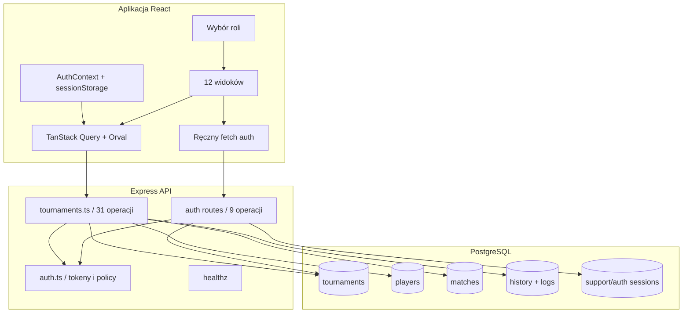
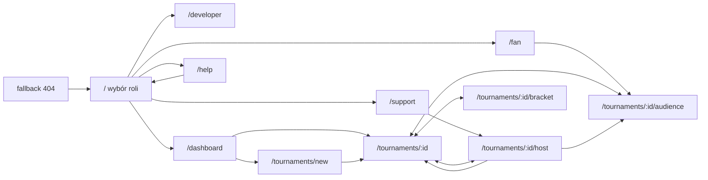
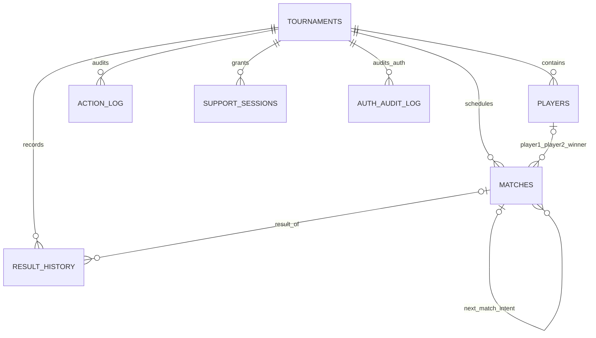
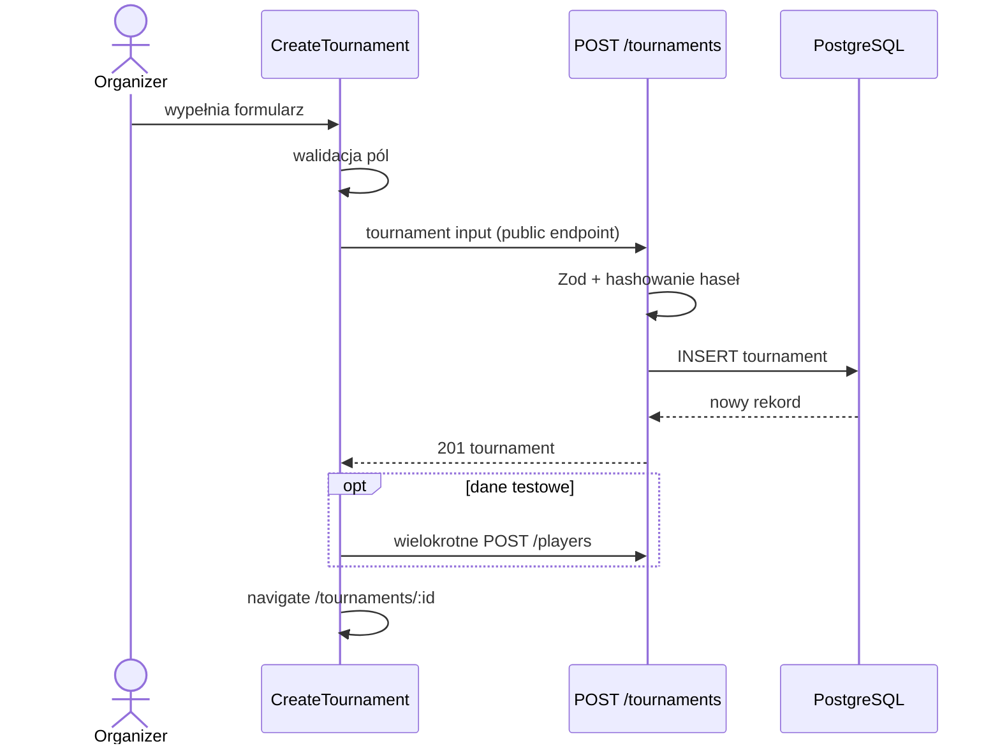
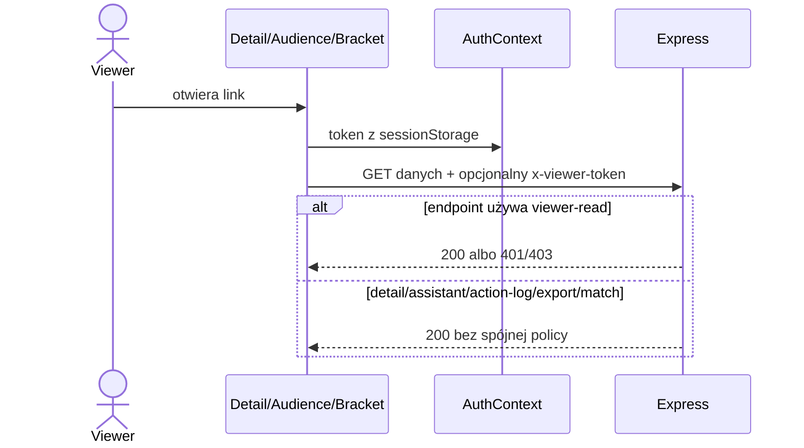
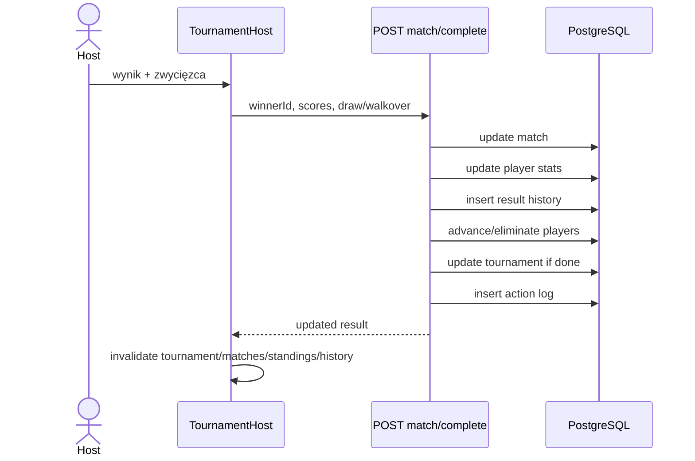
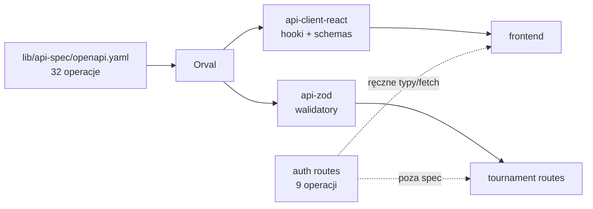

# Mapa funkcji i połączeń Tournament Manager

Data mapy: 2026-07-14
Zakres: runtime produktu (`tournament-manager` + `api-server` + `db`) oraz kontrakt generowany. Makieta `mockup-sandbox` jest wymieniona jako osobny artefakt, ale nie jest liczona jako funkcja produktu.

## 1. Liczby kontrolne

| Element | Liczba | Zasada liczenia |
|---|---:|---|
| Jawne trasy frontendowe | 11 | wpisy `<Route path>` w `App.tsx` |
| Fallback | 1 | osobny widok 404 |
| Widoki stron | 12 | komponenty w `src/pages` podłączone do routera |
| Funkcje użytkownika | 61 | niezależne intencje/akcje użytkownika F01–F61 |
| Operacje HTTP Express | 41 | metoda + ścieżka; 32 tournament/health + 9 auth |
| Operacje w OpenAPI | 32 | auth nie jest opisane w specyfikacji |
| Modele/tabele danych | 7 | tabele Drizzle |
| Role produktowe | 4 | developer, organizer, support, fan |

Statusy użyte w mapie:

- **Działa strukturalnie** — pełna ścieżka jest obecna w kodzie; bez DB nie oznacza pełnego E2E.
- **Runtime OK** — zachowanie zostało uruchomione podczas audytu.
- **Częściowe** — ścieżka istnieje, ale reguła lub format jest niepełny.
- **Ryzykowne** — funkcja istnieje, lecz ma istotną lukę bezpieczeństwa/integralności.
- **Brak** — UI może sugerować funkcję, ale właściwa implementacja nie istnieje.

## 2. Obraz systemu

## 3. Role i granice dostępu

| Rola | Wejście | Stan po stronie klienta | Credential | Dozwolony zakres według intencji | Rzeczywista granica |
|---|---|---|---|---|---|
| Developer | `/` → „Developer” | `tm_role` w localStorage | brak | panel narzędzi/development | tylko placeholder `/developer`; brak backendowej roli |
| Organizer | `/` → „Organizator” | rola + token per tournament w sessionStorage | hasło organizatora lub legacy host code | pełne zarządzanie, security, delete | per-endpoint token/header; route frontend nie jest chroniona |
| Support | `/` → „Wsparcie” | rola + session token per tournament | hasło wsparcia + nick | operacje gospodarza bez delete/security owner | sesja DB, ale bez TTL/revoke; część UI pokazuje akcje organizer-only |
| Fan | `/` → „Fan” | rola + opcjonalny viewer token | brak dla public; hasło widza dla private_online | odczyt | tylko endpointy wywołujące `checkViewerReadAuth`; kilka odczytów omija policy |

Wartość `tm_role` steruje doświadczeniem użytkownika, nie bezpieczeństwem. Każde uprawnienie musi być egzekwowane na API.

## 4. Trasy i widoki frontendowe

| # | Trasa | Widok / plik | Role/intencja | Wejście | Główne akcje i API | Sukces / błąd / wyjście |
|---:|---|---|---|---|---|---|
| R01 | `/` | `landing.tsx` | wszystkie | adres bazowy, zmiana roli | zapis `tm_role`; bez API | przejście developer→`/developer`, organizer→`/dashboard`, support→`/support`, fan→`/fan`; runtime OK |
| R02 | `/dashboard` | `dashboard.tsx` | organizer | landing lub link | lista, export, delete; tournaments/export/delete | karty→detail, new→create; lokalnie crash przez brak proxy API |
| R03 | `/developer` | `developer.tsx` | developer | landing | brak API | placeholder; runtime OK, funkcja częściowa |
| R04 | `/fan` | `fan-view.tsx` | fan | landing | lista aktywnych/ukończonych | karta→audience; przy złym payloadzie prawdopodobny crash `.filter` |
| R05 | `/support` | `support-entry.tsx` | support | landing | lista aktywnych, support-login | sukces→host; błędy loginu w formularzu |
| R06 | `/tournaments/new` | `create-tournament.tsx` | organizer | dashboard/direct URL | POST tournaments, dane testowe | sukces→detail; endpoint publiczny; walidacja klient+Zod |
| R07 | `/tournaments/:id` | `tournament-detail.tsx` | fan/viewer/support/organizer | listy, host/audience/bracket | szczegóły, gracze, start, CSV, backup, security, sharing | modale loginu, taby; kilka akcji ryzykownych |
| R08 | `/tournaments/:id/host` | `tournament-host.tsx` | organizer/support | support, detail, direct URL | kolejka, wynik, cancel/revert/undo/swap/reorder/generate | polling; 401/403 w akcji; duży moduł |
| R09 | `/tournaments/:id/audience` | `tournament-audience.tsx` | fan/projektor | fan, detail, host | odczyt tournament/matches/standings | polling 4/8 s; brak synchronizacji tokenu chronionego odczytu |
| R10 | `/tournaments/:id/bracket` | `tournament-bracket.tsx` | wszystkie czytające | detail | bracket + zoom/fullscreen | polling 10 s; brak synchronizacji tokenu |
| R11 | `/help` | `help.tsx` | wszystkie | nawigacja | statyczne accordiony | powrót `/` |
| R12 | fallback | `not-found.tsx` | wszystkie | nieznany URL | brak API | link opisany jako dashboard prowadzi do `/`; tekst nieaktualny |

### Graf nawigacji

Nie znaleziono statycznej pętli redirectów. Powrót przeglądarki jest standardowy dla Wouter; import backupu używa pełnego `window.location.href`, więc resetuje stan modułów.

## 5. Katalog 61 funkcji użytkownika

Kolumna „Przebieg” zawiera element UI → handler/hook → endpoint lub storage. „Rezultat” łączy wynik, błąd, nawigację i efekty uboczne. Szczegółowe payloady endpointów są w sekcji 6.

### 5.1. Wejście, listy i tworzenie

| ID | Funkcja | Rola / trasa / ekran / element | Przebieg i walidacja | Rezultat, błędy, nawigacja, efekt | Status |
|---|---|---|---|---|---|
| F01 | Wybrać rolę | wszystkie; `/`; kafle ról | `handleRoleSelect` → AuthContext/localStorage; enum UI | zapis roli i przejście do strony roli; brak serwera | Runtime OK |
| F02 | Zmienić rolę | wszystkie; layout/landing; nawigacja | link `/` → ponowny F01 | zastępuje `tm_role`; tokeny turniejowe mogą nadal istnieć w sessionStorage | Działa strukturalnie |
| F03 | Otworzyć pomoc | wszystkie; `/help`; accordion | stan lokalny, bez API | rozwija instrukcje, powrót `/`; dokumentacja częściowo nieaktualna | Działa strukturalnie |
| F04 | Otworzyć panel developera | developer; `/developer` | routing, brak API | renderuje placeholder i powrót | Częściowe |
| F05 | Przeglądać listę organizatora | organizer; `/dashboard`; karty/filtry statusu | `useListTournaments` → GET tournaments; brak guardu roli | lista/karty, empty/error; lokalnie zły HTML crashuje shape | Ryzykowne |
| F06 | Przeglądać turnieje fana | fan; `/fan`; sekcje active/completed | GET tournaments → `.filter` | przejście do audience; prywatne offline ukryte przez backend listy | Działa strukturalnie |
| F07 | Wybrać turniej wsparcia | support; `/support`; lista aktywnych | GET tournaments, wybór karty | otwiera formularz loginu; private_offline nie występuje na publicznej liście | Częściowe |
| F08 | Utworzyć turniej | organizer; `/tournaments/new`; formularz | `useCreateTournament` → POST tournaments; required/name/format/liczby/hasła | rekord + opcjonalne hashe; sukces→detail; publiczny endpoint | Ryzykowne |
| F09 | Dodać dane testowe przy tworzeniu | organizer; create; przełącznik/ustawienia | create, potem sekwencja POST players | dodatkowi gracze; brak wspólnej transakcji z create | Częściowe |
| F10 | Otworzyć szczegóły | wszystkie; listy; karta/link | route `/tournaments/:id`, GET tournament + zależne zapytania | taby/read gate/login; GET detail omija viewer policy | Ryzykowne |
| F11 | Pobrać szybki backup z dashboardu | organizer UI; dashboard; ikona download | GET export → Blob/download | plik JSON; endpoint nie wymaga auth | Ryzykowne |
| F12 | Usunąć turniej | organizer UI; dashboard; dialog | `useDeleteTournament` → DELETE; potwierdzenie | kasowanie cascade, invalidacja listy; anonimowo dla niezabezpieczonego | Ryzykowne |

### 5.2. Dostęp, podgląd i administracja

| ID | Funkcja | Rola / trasa / ekran / element | Przebieg i walidacja | Rezultat, błędy, nawigacja, efekt | Status |
|---|---|---|---|---|---|
| F13 | Czytać przegląd/statystyki/asystenta | viewer+; detail; overview cards | GET detail/stats/assistant; ID liczbowe | summary/checklist; assistant omija viewer auth | Ryzykowne |
| F14 | Zalogować organizatora | organizer; detail/modal lub query `login=organizer` | manual fetch organizer-login; hasło niepuste | token HMAC do sessionStorage, refetch; błąd w modalu | Działa strukturalnie |
| F15 | Zalogować wsparcie | support; support/detail/modal | support-login; hasło + nick | sesja DB do sessionStorage, przejście host/refetch | Działa strukturalnie |
| F16 | Zalogować widza | fan; detail/modal `login=viewer` | viewer-login; hasło | viewer token w sessionStorage, odblokowanie detail | Działa strukturalnie |
| F17 | Wylogować organizatora/wsparcie lokalnie | organizer/support; detail/host | usunięcie tokenu z sessionStorage/globalnego klienta | UI traci write access; serwerowa sesja support pozostaje ważna | Częściowe |
| F18 | Dodać gracza | organizer/support; detail/players; formularz | `useAddPlayer` → POST players; Zod input | insert+invalidacja; brak pełnego max/unique/lifecycle | Ryzykowne |
| F19 | Edytować gracza | organizer/support; detail/players; dialog | `useUpdatePlayer` → PATCH player | update+invalidacja; duplikat nazwy możliwy | Działa strukturalnie |
| F20 | Usunąć gracza | organizer/support; detail/players; dialog | `useDeletePlayer` → DELETE player | delete/invalidacja; możliwy konflikt z istniejącym meczem | Ryzykowne |
| F21 | Importować CSV w trybie append | organizer/support; detail/players | `useImportPlayers`; ręczny parser + preview | inserty, lista błędów wierszy; parser bez quoted CSV | Częściowe |
| F22 | Importować CSV w trybie replace | organizer/support; detail/players; potwierdzenie | POST players/import mode replace | delete roster + insert; brak transakcji | Ryzykowne |
| F23 | Pobrać przykładowy CSV | organizer/support; detail/players | generowanie Blob po stronie klienta | lokalny download; bez API | Działa strukturalnie |
| F24 | Uruchomić turniej | organizer/support; detail; przycisk start | `useStartTournament` → POST start; liczba graczy/format | generuje mecze, stats, status/log; brak transakcji; double błędne | Ryzykowne |
| F25 | Oglądać embedded schedule/drabinkę | viewer+; detail/matches/bracket | GET matches/bracket | komponent per format; viewer policy na tych endpointach | Działa strukturalnie |
| F26 | Oglądać tabelę | viewer+; detail/audience/host | GET standings | sortowane standing; RR/Swiss; polling zależny od strony | Działa strukturalnie |
| F27 | Oglądać historię wyników | viewer+; detail/host | GET results-history | lista wyników; viewer-read policy | Działa strukturalnie |
| F28 | Odhaczać checklistę turnieju | użytkownik urządzenia; detail/overview | localStorage key per tournament | stan tylko w danej przeglądarce, bez synchronizacji | Działa strukturalnie |
| F29 | Wyeksportować pełny backup | każdy z readOk UI; detail/backup | GET export → JSON | plik z danymi/logami; endpoint publiczny | Ryzykowne |
| F30 | Podejrzeć i importować backup | każdy z readOk UI; detail/backup | FileReader/luźne sprawdzenie v1 → POST import | nowa kopia i pełny reload; publiczne, bez transakcji | Ryzykowne |
| F31 | Zobaczyć sesje support | organizer w założeniu; security | GET auth/support-sessions; org token | lista session records; panel może być widoczny supportowi i dać 403 | Częściowe |
| F32 | Zobaczyć audit log auth | organizer; security | GET audit-log; org token | lista zdarzeń logowania/zmian | Działa strukturalnie |
| F33 | Zmienić hasło support | organizer; security; formularz | POST change-support-password | nowy hash + podniesienie wersji sesji | Działa strukturalnie |
| F34 | Zarządzać linkami dostępu | organizer; detail/sharing | generowanie URL/query client-side | copy links organizer/support/viewer; zależy od origin | Działa strukturalnie |
| F35 | Zmienić widoczność | organizer; sharing/security | POST change-visibility | public/private_online/private_offline + invalidacja | Działa strukturalnie |
| F36 | Ustawić/zmienić hasło widza | organizer; sharing/security | POST change-viewer-password | hash i flagi; stare HMAC nie są unieważniane | Ryzykowne |
| F37 | Zalogować legacy host code | organizer/legacy; hook/modal | verify-host-code → nagłówek `x-host-code` | kod w sessionStorage/global client | Częściowe |
| F38 | Ustawić/usunąć legacy host code | organizer/support wg PATCH policy; detail | PATCH tournament `hostCode` | jawna wartość w DB i storage | Ryzykowne |

### 5.3. Prowadzenie meczu i turnieju

| ID | Funkcja | Rola / trasa / ekran / element | Przebieg i walidacja | Rezultat, błędy, nawigacja, efekt | Status |
|---|---|---|---|---|---|
| F39 | Przeglądać kolejkę meczów | organizer/support; host; queue | GET matches co 5 s, lokalne sortowanie | pending/in-progress/postponed; błędy zapytania | Działa strukturalnie |
| F40 | Wybrać/fokusować następny mecz | organizer/support; host; karta/next | stan lokalny + PATCH status in_progress | panel wyniku; zapis statusu | Działa strukturalnie |
| F41 | Zmienić kolejność meczów | organizer/support; host; drag/control | POST reorder-matches; lista ID/priority | aktualizacja wielu rekordów + log; bez transakcji | Ryzykowne |
| F42 | Oznaczyć mecz w toku | organizer/support; host | PATCH match status `in_progress` | status + invalidacja; omija maszynę stanów | Częściowe |
| F43 | Odroczyć mecz | organizer/support; host | PATCH match status `postponed` | postponed; Swiss może potraktować jako done | Ryzykowne |
| F44 | Przywrócić odroczony mecz | organizer/support; host | PATCH match status pending/in_progress | powrót do kolejki | Działa strukturalnie |
| F45 | Zmienić best-of | organizer/support; host | PATCH match `bestOf` | nowe BO; walidacja schematu | Działa strukturalnie |
| F46 | Wyróżnić/odznaczyć mecz | organizer/support; host | PATCH tournament `featuredMatchId` | audience hero; brak sprawdzenia tego samego turnieju | Ryzykowne |
| F47 | Wprowadzać score lokalnie | organizer/support; host; +/- | lokalny state, ograniczenia UI | dopiero zatwierdzenie zapisuje; reset przy zmianie meczu | Działa strukturalnie |
| F48 | Zakończyć mecz ze zwycięzcą | organizer/support; host; confirm | POST complete, winnerId/scores | stats, history, log, awans; brak idempotencji/transaction/uczestnictwa | Ryzykowne |
| F49 | Zapisać remis | organizer/support; host | POST complete z draw | punkty obu graczy; brak centralnej kontroli czy format dopuszcza remis | Ryzykowne |
| F50 | Zapisać walkower | organizer/support; host | POST complete z flagą/result | winner/loser i historia | Częściowe |
| F51 | Anulować mecz | organizer/support; host; dialog reason | POST cancel; wymagany reason w schema | status cancelled + log | Działa strukturalnie |
| F52 | Przywrócić anulowany mecz | organizer/support; host | POST restore-cancelled | status pending + log | Działa strukturalnie |
| F53 | Zamienić strony/graczy | organizer/support; host | POST swap-players | player1↔player2 + log; wielozapisowo | Działa strukturalnie |
| F54 | Cofnąć wynik meczu | organizer/support; host/history | POST revert | cofa stats/winner/awans/history; brak transakcji, downstream risk | Ryzykowne |
| F55 | Cofnąć ostatnią akcję | organizer/support; host/action log | POST undo-last | interpretuje JSON payload logu i odwraca; race/casty | Ryzykowne |
| F56 | Wygenerować kolejną rundę Swiss | organizer/support UI; host | POST generate-round | nowe matches/byes; endpoint bez auth i concurrency guard | Ryzykowne |
| F57 | Przełączać taby hosta | organizer/support; host; tabs | lokalny stan + GET bracket/standings/history/action-log | różne reprezentacje stanu; action-log omija viewer auth, host ma token | Działa strukturalnie |
| F58 | Użyć pełnego ekranu i zoomu drabinki | viewer+; bracket; controls | Fullscreen API + local zoom | tryb projektora; browser API errors lokalne | Działa strukturalnie |
| F59 | Oglądać live audience | fan/viewer; audience | GET tournament/matches co 4 s, standings co 8 s | hero, queue, recent results/table; polling, nie live push | Działa strukturalnie |
| F60 | Kopiować linki z hosta | organizer/support zależnie UI; host; dialog | Clipboard API, URL z ID/query | schowek/toast; link nie zawiera sekretu, prowadzi do loginu | Działa strukturalnie |
| F61 | Obsłużyć nieznany adres | wszystkie; fallback 404 | Wouter fallback | komunikat i link `/`; opis linku jest nieaktualny | Działa strukturalnie |

### 5.4. Funkcje oczekiwane, ale nieobecne lub niepełne

| Obszar | Ocena |
|---|---|
| Double elimination | **Brak właściwej implementacji**; istniejący branch generuje single elimination |
| Ręczne tworzenie pojedynczego meczu | **Brak**; mecze powstają przez start/Swiss/import |
| Reset turnieju do draft | **Brak jawnego przypadku użycia**; są revert/undo/import |
| Wyszukiwanie graczy/turniejów | **Brak**; dostępne tylko proste filtry statusu |
| Konta globalne i właścicielstwo turniejów | **Brak**; dostęp jest per turniej |
| Prawdziwy live push | **Brak**; używany polling |
| Offline i synchronizacja po reconnect | **Brak** |
| Panel developera | **Placeholder** |
| Jawny viewer logout i revoke support session | **Brak pełnego cyklu UI/API** |

## 6. Powierzchnia API — 41 operacji

Legenda auth:

- `public` — bez credential;
- `viewer-read` — publiczny turniej albo viewer/support/organizer token;
- `host*` — organizer/support/legacy; gwiazdka oznacza obecny fallback anonimowy dla turnieju bez haseł;
- `organizer` — podpisany organizer token;
- `BRAK` — oczekiwana kontrola nie występuje.

### 6.1. Health i turnieje

| # | Metoda i ścieżka pod `/api` | Auth | Dane / skutek | Główny caller | Ocena |
|---:|---|---|---|---|---|
| A01 | GET `/healthz` | public | status procesu | deployment/smoke | OK |
| A02 | GET `/tournaments` | public | lista, bez private_offline | dashboard/fan/support | polityka listy częściowa |
| A03 | POST `/tournaments` | public | insert tournament + hashe | create | ryzyko spam/owner |
| A04 | GET `/tournaments/:id` | BRAK read policy | tournament DTO | detail/host/audience | P0 privacy |
| A05 | PATCH `/tournaments/:id` | host* | ustawienia/status/featured/legacy | detail/host | zbyt szeroki PATCH |
| A06 | DELETE `/tournaments/:id` | organizer/legacy/* | cascade delete | dashboard | P0 dla unprotected |
| A07 | POST `/tournaments/:id/verify-host-code` | public credential check | bool | legacy hook | rate limit brak |
| A08 | POST `/tournaments/:id/start` | host* | matches/stats/status/log | detail | nietransakcyjne |
| A09 | POST `/tournaments/:id/generate-round` | BRAK | Swiss matches/byes | host | P0 |
| A10 | GET `/tournaments/:id/bracket` | viewer-read | bracket projection | detail/bracket/host | OK policy |
| A11 | GET `/tournaments/:id/stats` | viewer-read | agregaty | detail | OK policy |
| A12 | GET `/tournaments/:id/standings` | viewer-read | tabela | detail/host/audience | tie-break risk |
| A13 | GET `/tournaments/:id/results-history` | viewer-read | historia wyników | detail/host | OK policy |
| A14 | GET `/tournaments/:id/assistant` | BRAK read policy | wskazówki/snapshot | detail/host | P0 privacy |
| A15 | GET `/tournaments/:id/players` | viewer-read | roster | detail | OK policy |
| A16 | POST `/tournaments/:id/players` | host* | insert player | detail | invariant gaps |
| A17 | POST `/tournaments/:id/players/import` | host* | append/replace CSV | detail | parser/transaction risk |
| A18 | PATCH `/players/:id` | host* przez tournament lookup | update player | detail | lifecycle/unique gaps |
| A19 | DELETE `/players/:id` | host* przez tournament lookup | delete player | detail | FK/lifecycle risk |
| A20 | GET `/tournaments/:id/action-log` | BRAK read policy | audit działań | host/detail security | P0 privacy |
| A21 | POST `/tournaments/:id/undo-last` | host* | wiele odwróconych zapisów | host | cast/race/transaction |
| A22 | GET `/tournaments/:id/matches` | viewer-read | schedule | detail/host/audience | OK policy |
| A23 | GET `/matches/:id` | BRAK read policy | pojedynczy mecz | brak znalezionego callera | P0 privacy |
| A24 | PATCH `/matches/:id` | host* | pola meczu/status | host | omija domain transitions |
| A25 | POST `/matches/:id/complete` | host* | wynik/stats/history/advance | host | P0 integrity |
| A26 | POST `/matches/:id/revert` | host* | cofnięcie wyniku | host | nietransakcyjne |
| A27 | POST `/matches/:id/cancel` | host* | cancel + reason/log | host | OK z ryzykiem transakcji |
| A28 | POST `/matches/:id/restore-cancelled` | host* | pending + log | host | OK z ryzykiem transakcji |
| A29 | POST `/matches/:id/swap-players` | host* | zamiana stron/log | host | invariant risk |
| A30 | POST `/tournaments/:id/reorder-matches` | host* | priorytety wielu meczów | host | nietransakcyjne |
| A31 | GET `/tournaments/:id/export` | BRAK | pełny backup | dashboard/detail | P0 data leak |
| A32 | POST `/tournaments/import` | public | nowa kopia wielu tabel | detail | P1 public/nontransactional |

### 6.2. Auth — operacje nieobecne w OpenAPI

| # | Metoda i ścieżka pod `/api` | Auth | Dane / skutek | Caller | Ocena |
|---:|---|---|---|---|---|
| A33 | POST `/tournaments/:id/auth/organizer-login` | public credential check | HMAC organizer token | organizer modal | brak rate limit/expiry |
| A34 | POST `/tournaments/:id/auth/support-login` | public credential check | support session + token | support modal/entry | plaintext token DB, brak TTL |
| A35 | GET `/tournaments/:id/auth/support-sessions` | organizer | sesje support | security panel | ręczny kontrakt |
| A36 | POST `/tournaments/:id/auth/change-support-password` | organizer | hash + session version | security panel | unieważnia wersją |
| A37 | POST `/tournaments/:id/auth/viewer-login` | public credential check | HMAC viewer token | viewer modal | brak expiry/version check |
| A38 | POST `/tournaments/:id/auth/change-viewer-password` | organizer | hash/flag | sharing/security | stare tokeny ważne |
| A39 | POST `/tournaments/:id/auth/change-visibility` | organizer | visibility | sharing/security | ręczny kontrakt |
| A40 | DELETE `/tournaments/:id/auth/viewer-password` | organizer | usuwa hash widza | brak znalezionego callera | funkcja niepodłączona |
| A41 | GET `/tournaments/:id/audit-log` | organizer | auth audit log | security panel | ręczny kontrakt |

## 7. Modele danych i relacje

| Model | Kluczowe pola | Relacje/owner | Zapisywany przez | Czytany przez | Luki |
|---|---|---|---|---|---|
| tournaments | name, format, status, visibility, rounds, passwords, featured/winner | root aggregate | create/import/start/PATCH/auth | prawie wszystkie widoki | hashe i legacy code w jednym rekordzie; featured/winner bez pełnej FK |
| players | name, teamName, seed, status, wins/losses/draws/points | tournamentId | CRUD, import, start/complete/revert/undo | roster, bracket, standings | brak unique per tournament; statystyki mutowane proceduralnie |
| matches | round, number, players, scores, winner, status, BO, queue | tournamentId | start/Swiss/import/host actions | detail/host/audience/bracket | participant IDs nie gwarantują samego turnieju; `nextMatchId` praktycznie nieużywany |
| result_history | match/player names, score, flags, completedAt | tournamentId, opcjonalny matchId | complete/import/revert | history/export | część ID bez FK, duplikaty przy retry |
| action_log | action, payload JSON, actor, time | tournamentId | większość mutacji | host/security/export/undo | payload luźny i rzutowany przy undo |
| support_sessions | token, nick, version, active timestamps | tournamentId | support-login/password change | auth/check/security | token jawny, brak TTL/revoke/logout |
| auth_audit_log | event, actor/IP/details/time | tournamentId | auth routes | security | brak retencji/limitów opisanych |

## 8. Główne przepływy end-to-end

### 8.1. Utworzenie turnieju

Luka: brak właściciela/auth tworzenia i brak transakcji obejmującej opcjonalne dane testowe.

### 8.2. Odczyt prywatnego turnieju

Luka: audience/bracket nie synchronizują stabilnie nagłówka, a część endpointów w ogóle nie sprawdza tokenu.

### 8.3. Dodanie/edycja/usunięcie gracza

UI detail → hook Orval → POST/PATCH/DELETE → `checkHostAuth` → Drizzle → invalidacja queries. Walidacja kształtu istnieje, ale reguły draft/max/unique i wpływ istniejących meczów nie są scentralizowane. Dla turnieju bez haseł `checkHostAuth` dopuszcza anonimowy request.

### 8.4. Start turnieju

UI detail → POST start → odczyt turnieju i graczy → generator zależny od formatu → delete/insert matches → reset stats → update tournament → action log. Kroki nie są objęte jedną transakcją. Double elimination kieruje do generatora single.

### 8.5. Zakończenie meczu

Krytyczne: brak transaction, idempotency i sprawdzenia uczestnika; ponowne/konkurencyjne żądanie może wykonać sekwencję drugi raz.

### 8.6. Cofnięcie wyniku i undo

Host → revert/undo → odczyt match/history/action payload → wiele korekt match/player/downstream/log. Operacje próbują odwrócić skutek, ale nie mają gwarancji atomowości ani wersji stanu. Revert downstream po rozegraniu następnego meczu może naruszyć drabinkę; wymaga jawnej polityki blokady lub kaskadowego planu.

### 8.7. Bracket i audience live

Nie ma kanału live. Host invaliduje cache własnej przeglądarki; inne urządzenia dowiadują się o zmianie przez polling:

- audience: tournament/matches co 4 s, standings co 8 s;
- host: tournament/matches/action log co około 5 s, assistant co 10 s;
- bracket: co 10 s;
- detail: assistant co 15 s, część innych danych bez aktywnego pollingu.

## 9. Cache, refresh, błędy i stan sesji

| Obszar | Aktualny mechanizm | Ryzyko |
|---|---|---|
| Query cache | staleTime 30 s, refetchOnWindowFocus false | detal może długo zachować stan bez invalidacji/pollingu |
| Mutacje | ręczne listy invalidowanych query keys | łatwo pominąć nowy konsument |
| Tokeny | sessionStorage per tournament + mutable globals w custom fetch | race na pierwszym request, utrata nagłówka po nawigacji |
| Rola | localStorage | przeżywa refresh, ale można ją dowolnie zmienić |
| Checklist | localStorage per tournament | tylko lokalne urządzenie |
| Błędy | toast/modal/inline zależnie strony | brak wspólnego error envelope i ekranu API unavailable |
| Offline | brak | request errors; brak kolejki ani czytelnego stale state |

## 10. Połączenia kontraktów i generowania

Źródło prawdy jest rozdzielone. Każdy nowy endpoint auth może zmienić się niezależnie od klienta i wygenerowanych walidatorów. Docelowo wszystkie 41 operacji powinno być objęte jednym kontraktem albo świadomie wersjonowanym podziałem specyfikacji.

## 11. Pokrycie i niepewności

Potwierdzono w runtime: typecheck, build z lokalnym obejściem, landing, przejście do developera, przejście organizatora do dashboardu oraz awarię dashboardu spowodowaną odpowiedzią HTML z `/api`. Potwierdzono w kodzie wszystkie trasy, 41 endpointów, 7 tabel, role i powiązania opisane wyżej.

Nieweryfikowalne lokalnie bez `DATABASE_URL`: realne logowanie, zapisy i rollbacki PostgreSQL, kompletne scenariusze formatów, Replit deployment, CORS w docelowej domenie i zachowanie przy wielu równoległych klientach. Te obszary muszą zostać pokryte testami z izolowaną bazą przed zmianami funkcjonalnymi.
