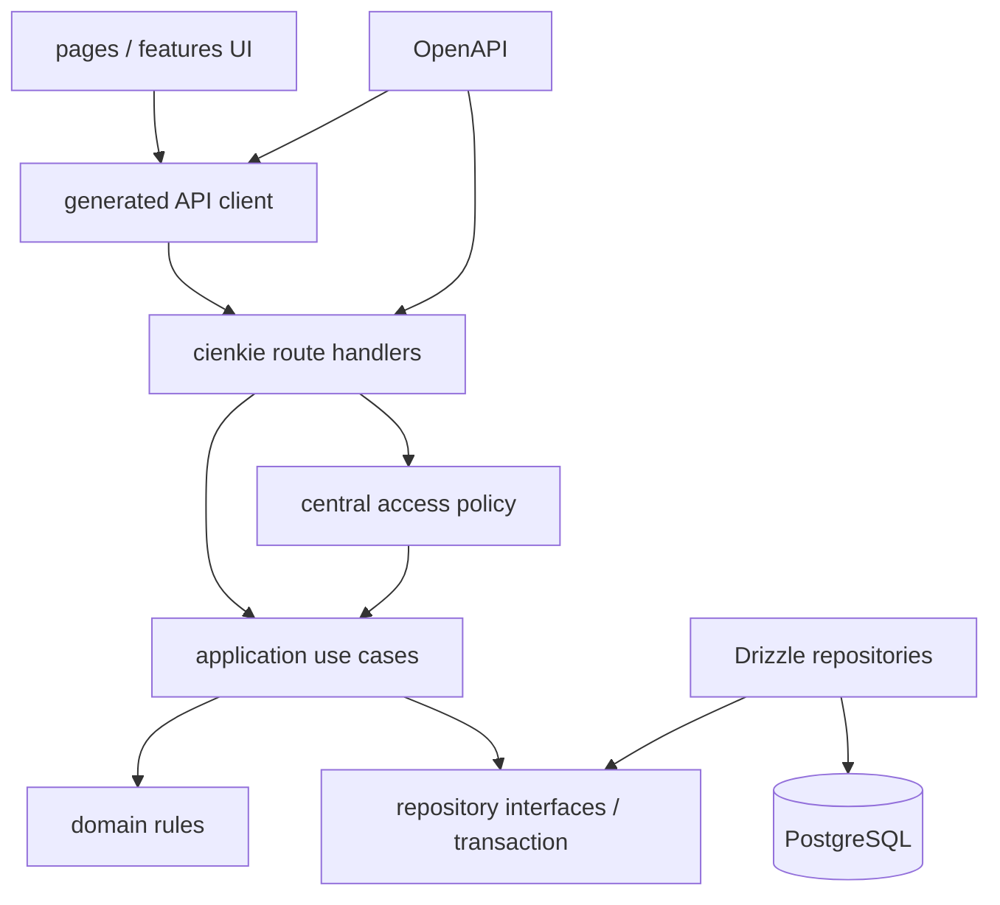

# Plan naprawy struktury Tournament Manager

Data planu: 2026-07-14
Podstawa: `AUDYT_STRUKTURY_APLIKACJI.md` i `MAPA_FUNKCJI_I_POLACZEN.md`.

## 1. Decyzja architektoniczna

Projekt powinien pozostać w obecnym stosie: React + Vite + Wouter + TanStack Query, Express, PostgreSQL, Drizzle, Zod i OpenAPI/Orval. Nie ma uzasadnienia dla rewrite'u ani migracji frameworka. Najbezpieczniejszą drogą jest naprawa wertykalnymi przypadkami użycia:

1. test zabezpiecza obecne lub oczekiwane zachowanie;
2. zamykana jest luka autoryzacji/integralności;
3. wielozapisowa operacja trafia do transakcji;
4. logika jest wydzielana z route/page tylko w zakresie dotkniętej funkcji;
5. kontrakt i klient są regenerowane;
6. wykonywany jest test regresji czterech ról.

Nie należy zaczynać od przenoszenia wszystkich plików, wymiany routera, stworzenia kont globalnych ani WebSocketów. Te zmiany nie usuwają P0 i zwiększyłyby zakres regresji.

## 2. Zasady prowadzenia prac

- jeden PR powinien zamykać jeden przypadek użycia lub jedną politykę dostępu;
- zachować istniejące URL i payloady, chyba że bezpieczeństwo wymaga świadomej zmiany;
- przed zmianą zachowania dodać test reprodukujący problem;
- każda operacja wykonująca więcej niż jeden zapis DB powinna mieć jawnie ocenioną granicę transakcji;
- request zawsze waliduje dane zewnętrzne Zod; TypeScript cast nie jest walidacją;
- UI może ukrywać niedostępne akcje, ale API jest jedyną granicą bezpieczeństwa;
- migracje są wersjonowane i odwracalne; `push` nie jest procesem produkcyjnym;
- w nowych modułach nie dodawać `any`, ręcznych query keys ani ręcznego fetch poza wspólnym klientem;
- po każdym etapie aplikacja ma pozostać wdrażalna na Replit.

## 3. Struktura docelowa — ewolucyjna

Poniższe drzewo jest kierunkiem, nie jednorazową operacją przenoszenia. Moduły powstają dopiero, gdy dana funkcja jest naprawiana.

```text
artifacts/
  api-server/src/
    app.ts
    config/
      env.ts                    # fail-fast i typowane env
    http/
      middleware/
        auth.ts                 # parse credential + request actor
        errors.ts               # wspólny error envelope
        rate-limit.ts
      routes/
        tournaments.ts          # cienkie adaptery HTTP
        players.ts
        matches.ts
        auth.ts
        backups.ts
    application/
      tournaments/
        create-tournament.ts
        start-tournament.ts
        generate-swiss-round.ts
      matches/
        complete-match.ts
        revert-match.ts
        change-match-state.ts
      players/
        import-players.ts
      access/
        tournament-policy.ts
      backups/
        import-tournament.ts
    domain/
      tournament/
        formats/
          single-elimination.ts
          round-robin.ts
          swiss.ts
        invariants.ts
        standings.ts
      match/
        result.ts
        state-machine.ts
    infrastructure/
      db/
        tournament-repository.ts
        match-repository.ts
        player-repository.ts
      auth/
        tokens.ts
artifacts/
  tournament-manager/src/
    app/
      router.tsx
      providers.tsx
      query-client.ts
    features/
      access/
      tournaments/
      players/
      matches/
      bracket/
      standings/
      backups/
    pages/                       # kompozycja feature'ów, mało logiki
    shared/
      api/
      ui/
      errors/
lib/
  api-spec/
    openapi.yaml                 # wszystkie 41+ operacji
  db/
    migrations/                 # wersjonowane migracje
    src/schema/
tests/
  integration/
  e2e/
```

### Zależności docelowe



Reguły zależności:

- domena nie importuje Express, React ani Drizzle;
- application nie serializuje HTTP i nie zna toastów;
- route mapuje request/actor → use case → response;
- repozytorium może używać zwykłego klienta DB lub transakcyjnego `tx`;
- frontend nie konstruuje nagłówków auth w stronach; robi to jeden klient;
- schema OpenAPI opisuje również auth i wspólny error envelope.

## 4. Plan etapów 0–6

Każdy etap zawiera cel, zakres, zależności, ryzyka, testy i kryterium zakończenia. Numery etapów oznaczają kolejność bezpieczeństwa, a nie konieczność jednego dużego PR.

## Etap 0 — baza pomiarowa i bezpieczne lokalne uruchomienie

**Cel:** stworzyć powtarzalne środowisko, w którym można dowieść napraw P0 bez ręcznych obejść.

**Zakres:**

- dodać typowaną walidację env i `.env.example` bez wartości sekretów;
- przygotować izolowaną bazę testową PostgreSQL i fixtures dwóch turniejów;
- dodać cross-platform skrypty `dev`, `build`, `test`, `lint` (`cross-env` zamiast `export`);
- naprawić politykę optional native Rollup dla wspieranych platform;
- dodać Vite proxy albo jawne `VITE_API_BASE_URL` oraz jeden skrypt full-stack;
- dodać test runner: Vitest + Supertest; Playwright tylko dla kilku smoke;
- dodać CI: install frozen, typecheck, lint, unit/integration, build;
- zachować bieżące zachowanie, poza kontrolowanym ekranem „API niedostępne” zamiast crashu na HTML.

**Zależności:** dostępna lokalna/testowa instancja PostgreSQL; ustalony port API; sekret testowy generowany w CI.

**Ryzyka:** test może przypadkowo wskazać produkcyjny `DATABASE_URL`; build Windows/Linux może różnić się lockfile.

**Ograniczenia ryzyka:** nazwa DB/test guard, zakaz uruchomienia test suite poza `_test`, żadnych sekretów w repo, osobne joby systemowe.

**Testy:** fresh install na Linux/Windows, `/api/healthz`, frontend pobiera JSON z `/api/tournaments`, kontrolowany błąd po zatrzymaniu API.

**Kryterium zakończenia:** jedna udokumentowana komenda uruchamia full-stack, a CI odtwarza typecheck/build/test bez audit-only workaround.

## Etap 1 — zamknięcie P0 autoryzacji i prywatności

**Cel:** żadna operacja ani reprezentacja prywatnych danych nie omija jednej polityki dostępu.

**Zakres:**

- zdefiniować `RequestActor`: anonymous, viewer, support, organizer;
- wprowadzić `requireTournamentRead`, `requireTournamentWrite`, `requireOrganizer`;
- usunąć z `checkHostAuth` automatyczny zapis/delete dla turnieju bez haseł;
- zabezpieczyć `generate-round`;
- zabezpieczyć detail, assistant, action-log i pojedynczy match polityką read;
- ograniczyć export i import backupu do organizatora; ukryć zakładkę w UI dla innych;
- określić migrację dla istniejących niezabezpieczonych turniejów: jednorazowy claim token lub obowiązkowe ustawienie hasła, nie anonimowy fallback;
- dodać walidację body auth i rate limit;
- produkcja fail-fast bez `SESSION_SECRET`; krótki TTL i wersja credential w tokenach;
- dodać revoke/logout dla support i viewer.

**Zależności:** test harness z etapu 0; decyzja produktowa, kto jest właścicielem istniejących turniejów.

**Ryzyka:** zablokowanie legalnego dostępu do starych turniejów; linki projektora przestaną działać bez viewer tokenu.

**Ograniczenia ryzyka:** migracja i komunikat w UI, feature flag krótkiego okresu claim, macierz kompatybilności linków.

**Testy:** dla każdej operacji macierz visibility × actor; test brak credential, błędny, wygasły, stara wersja, po zmianie hasła; test export/import organizer-only.

**Kryterium zakończenia:** wszystkie 41 endpointów mają jawnie udokumentowaną policy, a test automatyczny nie znajduje route bez deklaracji dostępu.

## Etap 2 — integralność meczu i transakcje P0

**Cel:** wynik jest poprawny domenowo, atomowy i bezpieczny przy retry/concurrency.

**Zakres:**

- wydzielić przypadek użycia `CompleteMatch`;
- sprawdzać, że match nie jest completed/cancelled, winner należy do player1/player2 i wszyscy należą do tego samego turnieju;
- jawnie walidować draw/walkover/scores względem formatu i bestOf;
- wykonać match, stats, history, advance/eliminate, tournament winner i action log w jednej transakcji;
- zastosować warunkowy update/optimistic version lub lock, zwracać 409 dla konfliktu/powtórki;
- ograniczyć generic PATCH: statusy domenowe tylko przez dedykowane use cases;
- w tej samej architekturze objąć `start`, `revert`, `undo`, `cancel/restore`, `swap` i `reorder`;
- zablokować revert, jeśli downstream match został rozegrany, albo wdrożyć przetestowany kaskadowy plan cofnięcia.

**Zależności:** etap 1 dla actor/policy; transakcyjne repozytoria; testowa DB.

**Ryzyka:** subtelna zmiana dotychczasowego naliczania punktów i undo; deadlock przy złej kolejności locków.

**Ograniczenia ryzyka:** stała kolejność zapisu/locków, golden fixtures przed refaktorem, logowanie request/action id.

**Testy:** retry, dwa równoległe complete, winner spoza meczu/turnieju, remis niedozwolony, rollback po wymuszonym błędzie każdego kroku, revert z rozegranym downstream.

**Kryterium zakończenia:** każda akcja meczu ma pojedynczą transakcję i deterministyczny wynik; powtórka nie zmienia statystyk.

## Etap 3 — poprawność formatów i schematu danych

**Cel:** wszystkie oferowane formaty mają jednoznaczne, przetestowane reguły, a DB chroni ich inwarianty.

**Zakres:**

- czasowo ukryć/wyłączyć double elimination, dopóki nie ma właściwego generatora;
- spisać reguły single, round robin i Swiss jako testowalne specyfikacje;
- Swiss: poprawne bye w każdej rundzie, postponed nie kończy rundy, lock na generowanie, finalizacja max rounds, tie-breaki i brak powtórnych par o ile możliwe;
- round robin: jawny tie-break i deterministyczny winner;
- gracze: unique normalized name per tournament, maxPlayers i lifecycle draft/active;
- mecze: unique `(tournamentId, round, matchNumber)` oraz walidacja referencji uczestników;
- featured/winner/next match: usunąć martwe pole albo wprowadzić spójną referencję;
- wdrożyć wersjonowane migracje z audytem istniejących niespójności.

**Zależności:** transakcyjna warstwa z etapu 2; decyzje regulaminowe; backup danych przed migracją.

**Ryzyka:** istniejące dane mogą naruszać nowe constrainty; zmiana tabeli może zmienić kolejność standings.

**Ograniczenia ryzyka:** raport pre-migration, migracja naprawcza w osobnym kroku, dry-run na kopii, możliwość rollback.

**Testy:** golden brackets 2/3/4/5/8 graczy; round robin remisy; Swiss 5/6/7/8, bye, postponed, max rounds, concurrency; constraint tests.

**Kryterium zakończenia:** aktywne formaty mają zatwierdzone specyfikacje i green golden tests; double elimination jest albo poprawne, albo niewybieralne.

## Etap 4 — jeden kontrakt API, cache i sesje frontendu

**Cel:** usunąć drift auth i niestabilną synchronizację tokenów.

**Zakres:**

- opisać 9 endpointów auth, actor/error envelopes i statusy 401/403/409/422 w OpenAPI;
- wygenerować klienta i schematy Zod dla całych 41 operacji;
- zastąpić ręczne fetch auth;
- klient request-time pobiera token właściwego turnieju, bez mutable module globals;
- wspólne query key factory i polityki cache dla detail/host/audience/bracket;
- jednolity ekran/komponent błędu, API unavailable i stale/offline indicator;
- E2E: login → navigation → refresh → logout/revoke;
- rozważyć SSE dopiero po pomiarze pollingu; nie jest warunkiem etapu.

**Zależności:** ustabilizowane endpointy etapów 1–3.

**Ryzyka:** regeneracja klienta zmieni nazwy hooków/typów; globalna zmiana query keys może ominąć invalidację.

**Ograniczenia ryzyka:** osobny PR spec/generation, mapa stary→nowy hook, testy kontraktu i E2E przed usunięciem starego klienta.

**Testy:** Express routes vs OpenAPI, schema response, protected refresh na trzech widokach, revoke w drugiej karcie, network offline/reconnect.

**Kryterium zakończenia:** brak ręcznego fetch dla API produktu i brak token state w globalnej zmiennej modułu; wszystkie endpointy generowane.

## Etap 5 — dekompozycja dużych modułów i porządek UI

**Cel:** zmniejszyć zakres zmian i umożliwić rozwój bez tworzenia kolejnych god objects.

**Zakres backend:**

- rozdzielić route files na tournaments/players/matches/backups/auth;
- przenosić już przetestowane przypadki użycia do `application`;
- wydzielić generatory formatów i standings do `domain`;
- wprowadzić cienkie repozytoria Drizzle przy use case, bez abstrakcji „na zapas”.

**Zakres frontend:**

- `tournament-host.tsx`: queue, score entry, match actions, host tabs jako features;
- `tournament-detail.tsx`: access gate, roster, overview, backup, security, sharing;
- wspólne label maps format/status, error handling i capabilities;
- route-level lazy loading dużych stron;
- security/backup/sharing widoczne z backendowych capabilities, nie z samych flag;
- jawne viewer/logout i support/revoke UX.

**Zależności:** testy i kontrakty etapów 0–4. Nie przenosić niepokrytej logiki turniejowej tylko dla estetyki.

**Ryzyka:** zmiany importów, utrata stanu lokalnego przy podziale komponentu, regresja invalidacji.

**Ograniczenia ryzyka:** po jednym feature na PR, zachowanie public API komponentu, testy komponentowe krytycznych dialogów.

**Testy:** component tests roster/score/access, E2E host happy path, build bundle comparison, statyczny test cykli importów.

**Kryterium zakończenia:** strony są kompozycją feature'ów, route handlers mapują HTTP na use cases, a żaden nowy moduł nie rośnie przez łączenie niezależnych funkcji.

## Etap 6 — operacje, obserwowalność i redukcja długu

**Cel:** bezpieczne wdrażanie i utrzymanie po naprawie krytycznych ścieżek.

**Zakres:**

- wersjonowane migracje, backup i runbook rollback Replit;
- structured logging z requestId/actionId bez haseł i tokenów;
- metryki: 4xx/5xx, login failures, latency, conflict 409, polling volume;
- retencja i indeksy audit log/session/history;
- dependency audit i usunięcie tylko potwierdzonego martwego kodu/pakietów;
- route lazy loading i budżet bundle;
- aktualny README, architektura, ADR dla auth/formatów i instrukcja lokalna/Replit;
- test restore backupu na kopii oraz okresowy disaster-recovery drill.

**Zależności:** ustabilizowany schemat i moduły.

**Ryzyka:** logi mogą przypadkowo zawierać payload z credential; cleanup może usunąć scaffold potrzebny później.

**Ograniczenia ryzyka:** centralna redakcja pól, retention policy, małe PR cleanup z pomiarem import graph/bundle.

**Testy:** log redaction, migration up/down na kopii, restore backup, production smoke po deployu, dependency/build audit.

**Kryterium zakończenia:** wdrożenie i rollback są odtwarzalne, alerty wykrywają awarie krytycznych flow, dokumentacja przechodzi fresh-clone test.

## 5. Kolejność PR-ów w pierwszym cyklu

Rekomendowana, możliwie mała seria:

| PR | Zawartość | Powód kolejności |
|---:|---|---|
| 0A | test DB, Supertest, fixtures, env guard, smoke health | pozwala dowodzić kolejnych poprawek |
| 0B | lokalne full-stack/proxy/cross-platform scripts | usuwa runtime blocker zespołu |
| 1A | centralna deklaracja policy + test matrix bez zmiany payloadów | pokazuje wszystkie luki w jednym raporcie |
| 1B | zabezpieczenie generate-round i brakujących read/export/import | bezpośrednie P0, mały zakres |
| 1C | usunięcie anonymous-write fallback + migracja claim | największa zmiana kompatybilności, wymaga komunikacji |
| 2A | `CompleteMatch` transaction + participant/idempotency checks | zamyka korupcję P0 |
| 2B | ograniczenie PATCH i transakcje revert/start | zamyka obejścia tej samej domeny |
| 3A | ukrycie double elimination + Swiss correctness tests | uczciwy zakres funkcji przed dalszym rozwojem |

## 6. Pierwsze konkretne zadanie naprawcze

### Tytuł

**„Testowa macierz dostępu i zamknięcie niechronionych odczytów/generate-round”**

### Dlaczego właśnie to

Łączy minimalny test harness z szybką redukcją kilku P0, nie wymagając jeszcze migracji modelu właściciela ani refaktoru całego kontrolera. Daje natychmiastową ochronę prywatnych danych i Swiss, a jednocześnie tworzy wzorzec middleware dla kolejnych route'ów.

### Zakres zadania

1. uruchomić integracyjną test DB i Supertest dla `app.ts`;
2. przygotować fixtures: public, private_online, private_offline oraz tokeny viewer/support/organizer;
3. napisać parametryzowaną macierz dla:
   - GET tournament detail,
   - GET assistant,
   - GET action-log,
   - GET match,
   - GET export,
   - POST generate-round;
4. dodać dwa middleware: `requireTournamentRead` i `requireTournamentWrite` na bazie istniejących funkcji auth;
5. zastosować read do pierwszych czterech GET, organizer-only do export, write organizer/support do generate-round;
6. ukryć Backup dla nie-organizatora;
7. nie zmieniać w tym zadaniu formatu tokenów, create ani fallbacku starych turniejów — to osobne PR-y, żeby ograniczyć regresję.

### Kryteria akceptacji

- anonymous ma 200 tylko dla odczytu publicznego;
- viewer ma 200 dla private_online po poprawnym haśle, ale nie dla private_offline;
- support/organizer mają oczekiwany odczyt, a tylko organizer pobiera backup;
- generate-round zwraca 401/403 bez write credential i działa dla organizer/support;
- wszystkie odpowiedzi auth mają spójny JSON error shape;
- frontend nie pokazuje Backup bez capability organizatora;
- typecheck, build i testy integracyjne przechodzą.

### Ryzyko regresji

Istniejący link do prywatnego backupu przestanie działać anonimowo, co jest zamierzoną poprawką. Audience i bracket nie są w tym zadaniu zmieniane, ale testy powinny potwierdzić, że publiczny odczyt nadal działa. Przed wdrożeniem trzeba sprawdzić, czy zewnętrzny skrypt korzysta z anonimowego exportu.

## 7. Macierz testów regresji

| Obszar | Test jednostkowy | Integracyjny API/DB | E2E UI | Manual/deployment |
|---|---|---|---|---|
| Auth policy | token parse/expiry/version | 41 route × actor matrix | direct URL/login/logout/refresh | linki na osobnym urządzeniu |
| Create | input rules | owner/auth, rollback fixtures | formularz + test data | Replit create |
| Players/CSV | normalize/duplicates/parser | append/replace transaction | preview/error/confirm | duży plik i polskie znaki |
| Start | generator golden | atomic start/retry | start dialog → matches | 2/3/5/8 graczy |
| Complete | score/result/state machine | concurrency/idempotency/rollback | host submit + audience update | dwa urządzenia równocześnie |
| Revert/undo | inverse rules | downstream guard/rollback | dialog/history | kopia realnego turnieju |
| Swiss | pairing/bye/tie-break | round lock/finalize | generate round | odd/even roster |
| RR | standings/tie-break | winner update | tabela/history | remis regulaminowy |
| Double elimination | bracket golden | pełny lifecycle | bracket/host | dopiero przed włączeniem |
| Privacy/export | field policy | visibility × actor | backup visibility | sprawdzenie pliku bez credential |
| Cache/session | query keys/token resolver | revoke response | detail→host→audience→refresh | offline/reconnect |
| Migrations | schema expectations | up/down + existing data | nie dotyczy | staging restore/rollback |

## 8. Definition of Done dla każdego etapu

Zmiana jest zakończona dopiero, gdy:

- ma zapisane kryterium bezpieczeństwa i zachowania;
- ma test reprodukujący wcześniejszy błąd oraz happy path;
- nie dodaje nowego `any` ani ręcznej rozbieżności z OpenAPI;
- wielozapisowa operacja ma transakcję lub udokumentowany powód jej braku;
- error response i log nie ujawniają credential;
- typecheck, lint, unit/integration i build przechodzą;
- dla zmiany UI wykonano test roli, direct URL, refresh i mobile minimum;
- dla zmiany DB istnieje migracja, precheck, backup i plan rollback;
- dokumentacja uruchomienia/kontraktu jest zaktualizowana;
- PR pozostaje mały i nie zawiera niezwiązanej reorganizacji plików.

## 9. Czego świadomie nie robić teraz

- nie wprowadzać microservices;
- nie zmieniać React/Express/Drizzle tylko z powodu rozmiaru plików;
- nie budować WebSocketów przed naprawą policy/cache/transactions;
- nie implementować kont globalnych w tym samym PR co zamknięcie P0;
- nie usuwać masowo komponentów shadcn ani zależności tylko na podstawie statycznego skanu;
- nie implementować double elimination bez zatwierdzonej specyfikacji i golden tests;
- nie „naprawiać” prywatności samym ukryciem przycisku — zawsze najpierw API;
- nie wykonywać produkcyjnych zmian schematu przez niekontrolowany `drizzle-kit push`.

## 10. Oczekiwany rezultat

Po etapach 0–2 aplikacja będzie miała zamknięte najgroźniejsze luki dostępu i atomową krytyczną ścieżkę wyniku. Po etapie 3 reguły aktywnych formatów będą mierzalne i chronione przez DB. Etap 4 usunie drift kontraktu oraz niestabilność sesji frontendu. Etapy 5–6 zmniejszą koszt zmian i dodadzą bezpieczny proces operacyjny. Całość zachowuje obecne rozwiązanie i URL-e, a strukturę poprawia tylko tam, gdzie istnieje przetestowany przypadek użycia.
